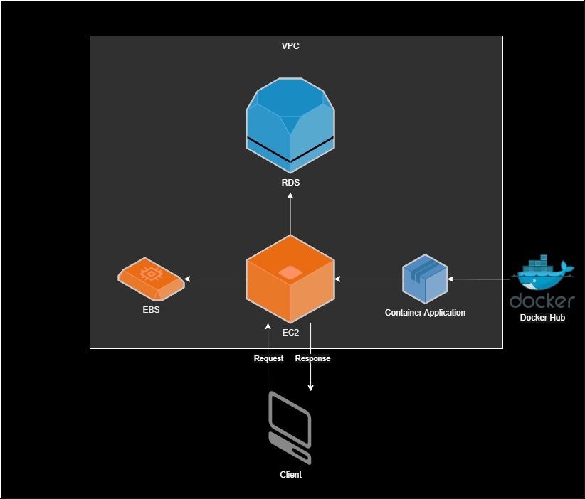

# Library API

API REST para gerenciamento de **livros** e **autores**, desenvolvida com **Java 21**, **Spring Boot** e **PostgreSQL**. O projeto conta com autenticação e autorização via **Spring Security**, **OAuth2** (login social com Google) e tokens **JWT**, além de um **Authorization Server** próprio (com suporte a OpenID Connect), documentação interativa com **Swagger/OpenAPI** e monitoramento com **Spring Boot Actuator**.

A aplicação é empacotada em uma imagem **Docker** (publicada no Docker Hub) e foi implantada na **AWS**, com a aplicação em uma instância **EC2** e o banco no **Amazon RDS (PostgreSQL)**.

> **Status: em desenvolvimento.** Novas funcionalidades e melhorias estão sendo adicionadas continuamente.

---

## Funcionalidades

- CRUD completo de **livros**, **autores** e cadastro de **usuários** e **clients** OAuth2
- Pesquisa de livros com **filtros combináveis** (ISBN, título, nome do autor, gênero e ano de publicação) e **paginação**, usando *JPA Specifications*
- Pesquisa de autores por nome e nacionalidade
- **Autenticação e autorização** com Spring Security:
    - Login com usuário e senha (senhas criptografadas com BCrypt)
    - Login social com **Google (OAuth2)**
    - Tokens **JWT** (access token de 60 minutos e refresh token de 90 minutos)
    - Claims personalizados no token (permissões e e-mail do usuário)
    - Controle de acesso por perfil (`OPERADOR` e `GERENTE`) com `@PreAuthorize`
- **Authorization Server** (Spring Authorization Server) com suporte a **OpenID Connect** e clients cadastrados no banco de dados
- **Documentação da API** com **Swagger/OpenAPI** (springdoc), com autenticação Bearer JWT configurada na interface
- **Monitoramento** com Spring Boot Actuator, em porta separada e restrito ao perfil `GERENTE`
- **Validações** de entrada com Bean Validation (incluindo validação de ISBN)
- **Regras de negócio**:
    - Não permite cadastrar ISBN duplicado
    - Não permite cadastrar autor duplicado (mesmo nome, data de nascimento e nacionalidade)
    - Preço é obrigatório para livros publicados a partir de 2020
- **Tratamento global de erros** com respostas padronizadas (400, 403, 409, 422 e 500)
- **Auditoria** automática de data de cadastro e de atualização
- Padrão **DTO** com mapeamento via **MapStruct**
- **Containerização** com Dockerfile multi-stage e configuração por variáveis de ambiente
- **Deploy na AWS** (EC2 + RDS) com grupos de segurança configurados

---

## Tecnologias

| Categoria | Tecnologia |
|---|---|
| Linguagem | Java 21 |
| Framework | Spring Boot |
| Persistência | Spring Data JPA, Hibernate, HikariCP |
| Banco de dados | PostgreSQL (Docker em desenvolvimento, Amazon RDS em produção) |
| Segurança | Spring Security, OAuth2 Client, Spring Authorization Server (OIDC), JWT |
| Validação | Bean Validation (Hibernate Validator) |
| Documentação | Swagger/OpenAPI (springdoc) |
| Monitoramento | Spring Boot Actuator |
| Mapeamento | MapStruct |
| Testes | JUnit, Spring Boot Test |
| Produtividade | Lombok |
| Build | Maven |
| Contêineres | Docker, Docker Hub |
| Nuvem | AWS (EC2, RDS, EBS, VPC, grupos de segurança) |
| Administração do banco | pgAdmin 4 |

---

## Estrutura do projeto

```
src/main/java/io/github/LucasDeveloper07/libraryapi
├── config/          # Configurações de segurança, Authorization Server e datasource
├── controller/      # Endpoints REST
│   ├── dto/         # Objetos de entrada e saída
│   ├── mappers/     # Mapeamento DTO <-> Entidade (MapStruct)
│   └── common/      # Tratamento global de exceções
├── exceptions/      # Exceções de negócio
├── model/           # Entidades JPA
├── repository/      # Repositórios e Specifications
├── security/        # Autenticação, login social e clients OAuth2
├── service/         # Regras de negócio
└── validator/       # Validadores de regras de negócio

aws/                 # Diagrama da arquitetura na AWS
Dockerfile           # Build multi-stage da imagem da aplicação
```

---

## Pré-requisitos

- [Java 21](https://adoptium.net/)
- [Docker](https://www.docker.com/) (para o PostgreSQL, o pgAdmin e a imagem da aplicação)
- Maven (ou use o Maven Wrapper `./mvnw` incluído no projeto)
- Credenciais OAuth2 do Google (para o login social): [Google Cloud Console](https://console.cloud.google.com/apis/credentials)

---

## Como executar localmente

### 1. Clone o repositório

```bash
git clone https://github.com/LucasDeveloper07/library-api.git
cd library-api
```

### 2. Suba o PostgreSQL e o pgAdmin com Docker

Baixe as imagens:

```bash
docker pull postgres:18.4
docker pull dpage/pgadmin4:9.16
```

Crie uma rede para que os contêineres se comuniquem:

```bash
docker network create library-network
```

Suba o **PostgreSQL**:

```bash
docker run --name librarydb \
  -e POSTGRES_USER=postgres \
  -e POSTGRES_PASSWORD=sua_senha \
  -e POSTGRES_DB=library \
  -p 5432:5432 -d \
  -v library-data:/var/lib/postgresql \
  --network library-network \
  postgres:18.4
```

Suba o **pgAdmin 4**:

```bash
docker run --name pgadmin4 \
  -e PGADMIN_DEFAULT_EMAIL=seu_email@exemplo.com \
  -e PGADMIN_DEFAULT_PASSWORD=sua_senha_pgadmin \
  -p 15432:80 -d \
  --network library-network \
  dpage/pgadmin4:9.16
```

| Serviço | Endereço | Credenciais |
|---|---|---|
| PostgreSQL | `localhost:5432` | usuário `postgres`, senha `sua_senha`, banco `library` |
| pgAdmin 4 | http://localhost:15432 | e-mail e senha definidos no comando acima |

> Ajuste usuário, senha, nome do banco e versão conforme o seu ambiente. O volume `library-data` mantém os dados salvos mesmo que o contêiner seja removido.

**Visualizando os dados no pgAdmin**

1. Acesse http://localhost:15432 e faça login.
2. Clique em **Add New Server**.
3. Na aba **General**, dê um nome ao servidor (ex.: `library-db`).
4. Na aba **Connection**, preencha:
    - **Host name/address:** `librarydb` (nome do contêiner do PostgreSQL, pois os dois estão na mesma rede Docker)
    - **Port:** `5432`
    - **Maintenance database:** `library`
    - **Username:** `postgres`
    - **Password:** `sua_senha`
5. Salve e navegue em **Servers > library-db > Databases > library > Schemas > public > Tables**. Clique com o botão direito em uma tabela e escolha **View/Edit Data > All Rows**.

Para parar e iniciar os contêineres novamente:

```bash
docker stop librarydb pgadmin4
docker start librarydb pgadmin4
```

### 3. Crie as tabelas

O projeto usa `ddl-auto: none`, ou seja, o Hibernate **não** cria as tabelas automaticamente. Execute o script abaixo no banco antes de iniciar a aplicação (pode ser pelo Query Tool do pgAdmin):

```sql
CREATE TABLE autor(
    id UUID NOT NULL PRIMARY KEY,
    nome VARCHAR(100) NOT NULL,
    data_nascimento DATE NOT NULL,
    nacionalidade VARCHAR(50) NOT NULL,
    data_cadastro TIMESTAMP,
    data_atualizacao TIMESTAMP,
    id_usuario UUID
);

CREATE TABLE livro(
    id UUID NOT NULL PRIMARY KEY,
    isbn VARCHAR(20) NOT NULL UNIQUE,
    titulo VARCHAR(150) NOT NULL,
    data_publicacao DATE NOT NULL,
    genero VARCHAR(30) NOT NULL,
    preco NUMERIC(18, 2),
    data_cadastro TIMESTAMP,
    data_atualizacao TIMESTAMP,
    id_usuario UUID,
    id_autor UUID NOT NULL REFERENCES autor(id),
    CONSTRAINT chk_genero CHECK (genero IN ('FICCAO', 'FANTASIA', 'MISTERIO', 'ROMANCE', 'BIOGRAFIA', 'CIENCIA'))
);

CREATE TABLE usuario(
    id UUID NOT NULL PRIMARY KEY,
    login VARCHAR(20) NOT NULL UNIQUE,
    senha VARCHAR(300) NOT NULL,
    email varchar(150) NOT NULL,
    roles VARCHAR[]
);

CREATE TABLE client(
    id UUID NOT NULL PRIMARY KEY,
    client_id VARCHAR(150) NOT NULL,
    client_secret VARCHAR(400) NOT NULL,
    redirect_uri VARCHAR(200) NOT NULL,
    scope VARCHAR(50)
);
```

### 4. Configure as variáveis de ambiente

A aplicação lê suas configurações sensíveis de variáveis de ambiente (nenhuma credencial fica no código):

| Variável | Descrição | Exemplo |
|---|---|---|
| `DATABASE_URL` | URL de conexão JDBC | `jdbc:postgresql://localhost:5432/library` |
| `DATABASE_USERNAME` | Usuário do banco | `postgres` |
| `DATABASE_PASSWORD` | Senha do banco | `sua_senha` |
| `GOOGLE_CLIENT_ID` | Client ID do Google OAuth2 | `xxxx.apps.googleusercontent.com` |
| `GOOGLE_CLIENT_SECRET` | Client Secret do Google OAuth2 | `xxxx` |

**Linux / macOS:**

```bash
export DATABASE_URL=jdbc:postgresql://localhost:5432/library
export DATABASE_USERNAME=postgres
export DATABASE_PASSWORD=sua_senha
export GOOGLE_CLIENT_ID=seu_client_id
export GOOGLE_CLIENT_SECRET=seu_client_secret
```

**Windows (PowerShell):**

```powershell
$env:DATABASE_URL="jdbc:postgresql://localhost:5432/library"
$env:DATABASE_USERNAME="postgres"
$env:DATABASE_PASSWORD="sua_senha"
$env:GOOGLE_CLIENT_ID="seu_client_id"
$env:GOOGLE_CLIENT_SECRET="seu_client_secret"
```

### 5. Execute a aplicação

```bash
./mvnw spring-boot:run
```

| Recurso | Endereço |
|---|---|
| API | http://localhost:8080 |
| Swagger UI | http://localhost:8080/swagger-ui.html |
| Actuator | http://localhost:9090/actuator (apenas `GERENTE`) |

> Localmente a aplicação inicia com o perfil padrão (logs de SQL ativados). Na imagem Docker, o perfil `production` é ativado pela variável `SPRING_PROFILES_ACTIVE` (logs de SQL desativados).

---

## Docker

### Dockerfile

O `Dockerfile` usa **build multi-stage**:

1. **build:** imagem `maven` com Amazon Corretto 21 compila o projeto (`mvn clean package -DskipTests`).
2. **run:** imagem `amazoncorretto` com Java 21 recebe apenas o JAR gerado, o que deixa a imagem final menor.

Variáveis de ambiente definidas na imagem: `DATABASE_URL`, `DATABASE_USERNAME`, `DATABASE_PASSWORD`, `GOOGLE_CLIENT_ID`, `GOOGLE_CLIENT_SECRET`, `SPRING_PROFILES_ACTIVE=production` e `TZ=America/Sao_Paulo`. Os valores reais devem ser informados na criação do contêiner (`-e`), nunca na imagem.

### Build e execução

```bash
# Build da imagem (na pasta do Dockerfile)
docker build --tag devlucasf/libraryapi .

# Execução do contêiner
docker run -d --name libraryapi \
  -e DATABASE_URL=jdbc:postgresql://<endereco-do-banco>:5432/library \
  -e DATABASE_USERNAME=<usuario> \
  -e DATABASE_PASSWORD=<senha> \
  -e GOOGLE_CLIENT_ID=<client_id> \
  -e GOOGLE_CLIENT_SECRET=<client_secret> \
  -p 8080:8080 \
  devlucasf/libraryapi
```

> A porta `9090` (Actuator) não deve ser publicada em ambientes expostos à internet.

Para enviar a imagem ao Docker Hub:

```bash
docker login
docker push devlucasf/libraryapi
```

---

## Deploy na AWS

A aplicação foi implantada na AWS com a seguinte arquitetura:



| Componente | Função |
|---|---|
| **Docker Hub** | Armazena a imagem da aplicação |
| **EC2** (Amazon Linux) | Executa o Docker e o contêiner da aplicação |
| **EBS** | Volume de armazenamento da instância EC2 |
| **RDS** (PostgreSQL) | Banco de dados gerenciado, na mesma VPC do EC2 |
| **Grupos de segurança** | Controlam o tráfego de entrada de cada recurso |

### Passo a passo

**1. Crie o banco no Amazon RDS**

- Mecanismo: PostgreSQL, com o banco inicial `library`.
- Acesso público: **desativado**.
- VPC: a mesma da instância EC2.
- Depois de criado, execute o script SQL da seção [Crie as tabelas](#3-crie-as-tabelas) no banco.

**2. Crie a instância EC2**

- Sistema operacional: Amazon Linux.
- Associe um grupo de segurança conforme a tabela da próxima seção.

**3. Instale o Docker na instância**

```bash
sudo yum update
sudo yum install docker
sudo service docker start
```

**4. Execute a aplicação**

```bash
sudo docker run -d --name libraryapi --restart unless-stopped \
  -e DATABASE_URL=jdbc:postgresql://<endpoint-do-rds>:5432/library \
  -e DATABASE_USERNAME=<usuario> \
  -e DATABASE_PASSWORD=<senha> \
  -e GOOGLE_CLIENT_ID=<client_id> \
  -e GOOGLE_CLIENT_SECRET=<client_secret> \
  -p 8080:8080 \
  devlucasf/libraryapi
```

A imagem é baixada automaticamente do Docker Hub na primeira execução.

**5. Acompanhe os logs e o estado do contêiner**

```bash
sudo docker ps            # contêineres em execução
sudo docker ps -a         # inclui os parados
sudo docker logs -f libraryapi
sudo docker stop libraryapi
```

### Grupos de segurança

| Recurso | Porta | Origem | Finalidade |
|---|---|---|---|
| EC2 | 8080 (TCP) | Internet ou IPs autorizados | Acesso à API |
| EC2 | 22 (TCP) | Apenas o seu IP | Acesso SSH |
| RDS | 5432 (TCP) | **Grupo de segurança do EC2** | Conexão da aplicação com o banco |

Boas práticas adotadas:

- O RDS **não é acessível pela internet**: aceita conexões somente do grupo de segurança do EC2.
- A porta `9090` (Actuator) **não é aberta** no EC2.
- Nenhuma credencial fica no código ou na imagem: tudo é injetado por variáveis de ambiente.

### Cuidados com custos

Depois dos testes, encerre os recursos que não estiverem em uso: instância EC2, volumes EBS, snapshots, Elastic IPs e o banco RDS. Configure alertas de orçamento (AWS Budgets) para acompanhar os gastos.

---

## Autenticação e autorização

| Perfil | Permissões |
|---|---|
| `GERENTE` | Acesso total: livros, autores e clients |
| `OPERADOR` | Consulta, cadastro, atualização e exclusão de livros; consulta de autores |

- O cadastro de usuários (`POST /usuarios`) é público.
- Todos os demais endpoints exigem autenticação (Basic, login por formulário, login com Google ou token JWT).
- No login social com Google, um usuário novo é criado automaticamente com o perfil `OPERADOR`.
- O **Authorization Server** utiliza os fluxos `authorization_code` e `client_credentials`, com clients cadastrados na tabela `client` (via `POST /clients`, restrito a `GERENTE`).
- Endpoints do Authorization Server:

| Endpoint | Finalidade |
|---|---|
| `/oauth2/authorize` | Autorização |
| `/oauth2/token` | Obtenção do token |
| `/oauth2/introspect` | Consulta do status do token |
| `/oauth2/revoke` | Revogação do token |
| `/oauth2/userinfo` | Informações do usuário (OpenID Connect) |
| `/oauth2/jwks` | Chave pública para verificar a assinatura do token |
| `/oauth2/logout` | Logout |

- Os endpoints da API aceitam token JWT no header `Authorization: Bearer <token>`.

---

## Endpoints

### Livros (`/livros`)

| Método | Rota | Descrição | Perfil |
|---|---|---|---|
| `POST` | `/livros` | Cadastra um livro | OPERADOR, GERENTE |
| `GET` | `/livros/{id}` | Detalhes de um livro | OPERADOR, GERENTE |
| `GET` | `/livros` | Pesquisa com filtros e paginação | OPERADOR, GERENTE |
| `PUT` | `/livros/{id}` | Atualiza um livro | OPERADOR, GERENTE |
| `DELETE` | `/livros/{id}` | Remove um livro | OPERADOR, GERENTE |

**Parâmetros da pesquisa** (todos opcionais): `isbn`, `titulo`, `nome-autor`, `genero`, `ano-publicacao`, `pagina` (padrão `0`) e `tamanho-pagina` (padrão `10`).

Gêneros disponíveis: `FICCAO`, `FANTASIA`, `MISTERIO`, `ROMANCE`, `BIOGRAFIA`, `CIENCIA`.

### Autores (`/autores`)

| Método | Rota | Descrição | Perfil |
|---|---|---|---|
| `POST` | `/autores` | Cadastra um autor | GERENTE |
| `GET` | `/autores/{id}` | Detalhes de um autor | OPERADOR, GERENTE |
| `GET` | `/autores` | Pesquisa por `nome` e `nacionalidade` | OPERADOR, GERENTE |
| `PUT` | `/autores/{id}` | Atualiza um autor | GERENTE |
| `DELETE` | `/autores/{id}` | Remove um autor | GERENTE |

### Usuários e clients

| Método | Rota | Descrição | Acesso |
|---|---|---|---|
| `POST` | `/usuarios` | Cadastra um usuário | Público |
| `POST` | `/clients` | Cadastra um client OAuth2 | GERENTE |

---

## Documentação da API (Swagger)

Com a aplicação em execução, acesse http://localhost:8080/swagger-ui.html para visualizar e testar os endpoints. A especificação OpenAPI está disponível em `/v3/api-docs`.

Para testar endpoints protegidos, clique em **Authorize** e informe um token JWT (esquema `bearerAuth`).

---

## Exemplos de requisição

**Cadastrar autor**

```http
POST /autores
Content-Type: application/json

{
  "nome": "Machado de Assis",
  "dataNascimento": "1839-06-21",
  "nacionalidade": "Brasileira"
}
```

**Cadastrar livro**

```http
POST /livros
Content-Type: application/json

{
  "isbn": "978-85-359-0277-5",
  "titulo": "Dom Casmurro",
  "dataPublicacao": "1899-01-01",
  "genero": "ROMANCE",
  "preco": 39.90,
  "idAutor": "id-do-autor-cadastrado"
}
```

**Pesquisar livros**

```http
GET /livros?titulo=casmurro&genero=ROMANCE&pagina=0&tamanho-pagina=10
```

**Exemplo de resposta de erro** (`422 Unprocessable Content`)

```json
{
  "status": 422,
  "mensagem": "Erro de validação.",
  "erros": [
    {
      "campo": "preco",
      "erro": "Para livros com o ano de publicação a partir de 2020, o preço é obrigatório."
    }
  ]
}
```

### Códigos de resposta

| Status | Situação |
|---|---|
| `201 Created` | Recurso criado (header `Location` com a URL do novo recurso) |
| `204 No Content` | Atualização ou exclusão realizada com sucesso |
| `400 Bad Request` | Operação não permitida |
| `403 Forbidden` | Usuário sem permissão para a operação |
| `404 Not Found` | Recurso não encontrado |
| `409 Conflict` | Registro duplicado (ISBN ou autor) |
| `422 Unprocessable Content` | Erro de validação |
| `500 Internal Server Error` | Erro inesperado |

---

## Testes

O projeto possui 19 testes de repositório com JUnit para as operações de autores e livros (salvar, atualizar, listar, excluir e consultas personalizadas).

```bash
./mvnw test
```

---

## Próximos passos

- [x] Containerizar a aplicação com Docker e publicar a imagem no Docker Hub
- [x] Realizar o deploy da aplicação na AWS (EC2 + RDS)
- [ ] Criar um `docker-compose.yml` para subir a aplicação, o banco e o pgAdmin com um único comando
- [ ] Persistir a chave RSA de assinatura dos tokens (hoje ela é gerada a cada inicialização, o que invalida os tokens após reiniciar o contêiner)
- [ ] Configurar HTTPS com domínio próprio
- [ ] Criar um pipeline de CI/CD (build, testes e publicação da imagem)
- [ ] Restringir a exposição dos endpoints do Actuator

---

## Autor

**Lucas Felipe da Silva Araujo**
Estudante de Análise e Desenvolvimento de Sistemas (Fatec Ipiranga) | Back-end Java

[](https://www.linkedin.com/in/lucasfelipedev)
[](https://github.com/LucasDeveloper07)
